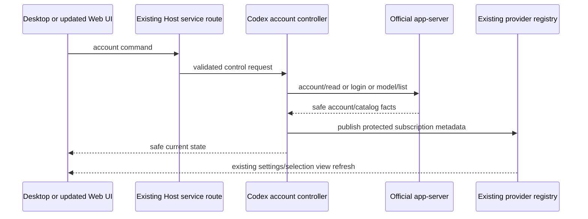

# ChatGPT subscription authentication for Codex projects

## Product behavior

Manage Models exposes a dedicated **ChatGPT subscription (Codex)** entry. Login uses the official installed Codex app-server's ChatGPT login/device authorization flow. ZCode never requests a password or serializes OAuth tokens into provider configuration, RPC payloads, logs or UI state. Codex's credential store in the target environment's existing codex home is the only credential owner.

### Desktop browser authorization and device-code failures (2026-11-04)

Installed Codex does not guarantee that its device-authorization endpoint is reachable. On the reported Windows installation, discovery, initialization and account/read succeeded, but `account/login/start` with `chatgptDeviceCode` returned HTTP 403. The official `chatgpt` browser OAuth flow successfully returned an authorization URL and could be cancelled in an isolated home. Do not label this device-code failure as a missing installation.

The local desktop login button explicitly requests `loginMethod: browser`; a separate device-code option remains available. Web/mobile and remote Settings environments request device-code login and never open another computer's loopback OAuth callback. Legacy commands with no loginMethod keep device-code behavior. There is no automatic switch between methods or authentication sources. Both flows share the existing account controller, serial command queue, login ID/generation, ten-minute timeout, cancellation and official login completion handling. Only an explicit click starts a login or opens an authorization page; read/poll do neither.

The shared command accepts optional `loginMethod: browser | device-code`. Pending login preserves the legacy device shape `{loginId, verificationUrl, userCode}` (optional `type: device-code`) or uses `{loginId, type: browser, authorizationUrl}`. Browser URLs are accepted only at HTTPS `auth.openai.com/oauth/authorize`, with no port, credentials or fragment, and an HTTP loopback `/auth/callback` redirect without credentials/query/fragment. OAuth response type, S256 challenge and state are validated once through the shared URL schema; ZCode never constructs or rewrites the official URL. A browser login observed by Web/remote Settings shows instructions to finish on the local computer and offers cancel, without a browser-login link. Account state may carry fixed `errorCode: device-auth-unavailable` when device-code acquisition fails; raw errors, URLs and tokens are never included in diagnostics. UI localizes this category with a desktop browser-login suggestion. Other failures retain the existing generic fixed error.

Desktop continuous and mobile replayable clients still observe the same CLI-owned login. Pending state and cancellations remain correlated by login ID/generation; a late completion cannot revive a cancelled login. Browser failure does not fall back to API, device code or another account. The provider catalog remains empty until official authentication and catalog discovery complete.

Acceptance covers legacy and explicit method requests, both pending shapes, official browser URL validation (including rejected foreign redirects), device failure classification/redaction, unchanged polling/timeout/cancel/late-completion semantics, and actual desktop/mobile buttons. Isolated real-binary acceptance must start and cancel browser OAuth without opening the URL or completing account login; real browser authorization by the user remains manual.

The account controller exposes read, refresh, login, cancel and logout commands through the existing authenticated Host/CLI service route. There is one controller per CLI process/codex home. Repeated read commands observe pending login, not start another authorization. Login/cancel/logout are serialized; stale login completion must not replace newer state. UI polling observes owner state and ends on unmount. Responses contain safe account labels, pending authorization URL/code and a validated official model catalog only. Untrusted arbitrary authorization URLs must never be opened.

The reserved provider ID is `chatgpt-subscription`; access type is `codex-chatgpt`. It is Codex-only. No API key, custom endpoint, custom headers, custom model ID, reasoning map or capability edits are supported. The official `model/list` catalog determines available model IDs and reasoning efforts; do not hardcode a supposedly entitled model or silently substitute a model. Personal preference controls may only narrow official availability. The normal API model factory rejects subscription selections before creating an API client.

## Owner and configuration contract

Only the controller may publish the reserved provider's official catalog. Generic provider/model mutations, including old Web clients, cannot create/spoof, replace, rename, delete or rewrite subscription identity, connection or official model definitions. Enforcement belongs at the configuration write owner, not only the UI. Configuration import cannot silently convert/remove the protected subscription entry. Stored catalog data contains no credentials and execution revalidates current account/catalog before sending a turn. Logged-out/stale/unavailable selections fail explicitly; no API fallback or automatic billing-source change.

Desktop continuous delivery and Web/mobile replayable delivery use the existing Host attachment, runtime admission, input identity and registry refresh paths. No independent Web credential store or Agent is created. The deployed official website is not changed by building this repository; old clients can select a compatible published catalog but receive an explicit error for unsupported editing. Updated Web UI uses the same account owner as Desktop. Authorization device code supports login from another device without relying on a phone's localhost callback.

## Execution and changes over time

Official model discovery is not an entitlement or quota check: a listed model may still be rejected by the server. Reasoning effort labels are bounded extensible identifiers, validated against that model's current official catalog (including `max`/`ultra` where returned). Registry-only token budget fields use the explicit placeholder `1` because the directory supplies no such numbers; the Codex executor never uses these placeholders for truncation, output limits or displayed subscription quotas.

Each admitted turn resolves the exact provider/model and freezes its resolved launch configuration. Editing preferences/choosing a different model affects subsequent turns, not a running turn. API credentials/environment must not contaminate subscription launch; subscription authentication must not contaminate API launch. Existing thread identity/history must be preserved. Cross-authentication resume must either be verified against the installed official binary or rejected before dispatch with an actionable new-task message; never silently fork, replay input or rewrite thread metadata.

Account changes, cancellation, login expiry, catalog failure and unavailable models are visible errors with safe fixed messages. Do not expose upstream raw authentication errors. Logging out is explicit and does not retry a running turn using another account/provider.

## Acceptance

### Engine-aware model selection presentation

The existing ProjectDirectoryProvider remains the only project/task fact owner. Its immutable fact-tree projection supplies project executionEngine to SessionPane, then ConversationComposer and the model toolbar. Existing tasks resolve by host ID plus exact task/workspace identity and their stored project membership; draft tasks resolve by host ID plus explicit draft project ID. Identical filesystem directories never imply project identity. Missing/ambiguous membership or an unavailable directory owner yields an unknown engine. Legacy projects without an executionEngine field remain ZCode.

Only a positively identified Codex project exposes the ChatGPT subscription group. ZCode and unknown contexts omit subscription candidates. The same derived filtering applies before draft initialization, retained loading catalogs, explicit refresh results, and submission configuration validation, so an unknown context cannot initialize or submit a subscription model through a hidden preferred selection. Filtering does not persist a different selection or change credentials; an incompatible stored subscription selection stays unavailable until the user chooses a valid model or opens the appropriate project. The Host's engine guard remains authoritative for legacy clients and stale projections.

Browser acceptance covers two different-engine projects sharing a cwd, identical project/task IDs on different hosts, explicit Codex/ZCode drafts, legacy projects, unknown or ambiguous membership, retained subscription preference removal, and valid API candidates staying selectable.

- Official ChatGPT login, pending state, successful status refresh, cancellation, logout, missing binary and protocol failures have repeatable CLI tests; actual user browser authorization remains a manual check.
- Official model IDs and supported efforts roundtrip through registry and selection; arbitrary model IDs fail before dispatch.
- Legacy Web provider/model edit attempts and import attempts cannot corrupt the reserved provider, including during account refresh.
- API execution still uses the selected API key; subscription starts with official auth and without inherited API override credentials.
- Existing thread resume, same-auth model switch and cross-auth boundary are explicitly tested without paid calls, replay or history loss.
- UI has repeatable browser scenarios for login/cancel/status, catalog display, read-only model identity, unavailable state, and desktop/mobile widths.
- Root and CLI typecheck/lint plus affected tests and architecture gate run; unavailable real-account and OS acceptance are reported honestly.
