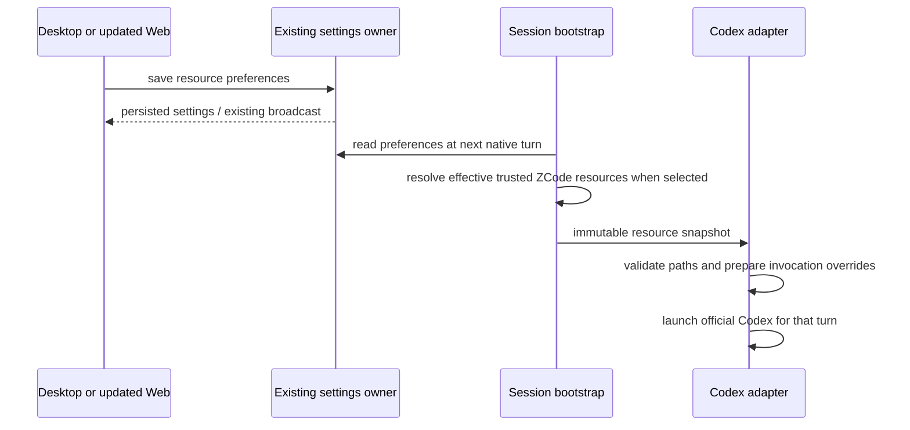

# Codex MCP and skill sources

MCP and skill synchronization catalogs have independent, initially collapsed disclosure controls. Their headers remain visible whenever the corresponding synchronization switch is on, including catalog loading, empty and error states; a ready header shows the resource count. Expanding a catalog reveals its existing description, status and selection controls. Candidate rows occupy a bounded, keyboard-focusable internally scrolling region so large catalogs cannot grow the settings page without bound. Collapsing, reopening or refreshing never changes synchronization preferences or unsaved selections. Expansion is local presentation state only, is not persisted or broadcast, and resets when the catalog is remounted. Acceptance covers independently opening/closing both catalogs, selection retention, reachable Save with many resources, keyboard access and narrow/wide layouts in the active light/dark themes.

Enabling skill synchronization shows the executing Host's existing ZCode skill catalog with per-skill selection. Enabled skills default on; skills disabled in ZCode remain visible, off and unselectable. This control affects only Codex synchronization and never changes ZCode enabled state, skill files or plugin configuration. AppSettings alone owns `codexSkillDisabledPaths: string[]` (default empty, at most 4096 absolute SKILL.md paths): manual opt-outs survive save/reload, disabling synchronization and temporarily unavailable skills; newly discovered enabled skills default on. Skill identity is the discovered canonical SKILL.md path, not the name, so same-name skills can be selected independently. Windows path keys compare case-insensitively and normalize separators; POSIX keys remain case-sensitive, independent of the browser OS.

The existing skills service adds `listCodexSyncCandidates({workspacePath, workspaceIdentity?})`, returning only `{name, path, scope, enabled, pluginName?}` metadata from the same discovery/enabled-state owner as native resource synchronization. It does not expose skill bodies, change enabled state or execute skills. The settings hook discards results from a previous workspace/service, supports loading/error/retry/empty/unavailable states, and does not load the catalog when synchronization is off. The UI shows name, scope/plugin and path to distinguish entries, preserving unknown exclusions when saving. Selection does not establish that a skill's required tools are available in Codex; native mandatory/system skills remain controlled by Codex.

At the next native turn the Host reads persisted exclusions and projects only enabled selected skill paths. The CLI carries the preference through existing native resource snapshots and filters both Host-supplied and local fallback paths; the adapter rechecks selection for direct callers. Excluded files are filtered before reading them, so a stale excluded missing file cannot break execution. Preferences and selected paths are copied for the immutable turn; an in-flight turn keeps its existing snapshot. Sync-off custom/default discovery ignores exclusions, retaining them for later sync use. Existing desktop continuous/mobile replayable attachment and settings persistence remain the same single Host path.

Skill selection acceptance adds default/schema/patch bounds, independent same-name skills, Windows/POSIX path equality, manual opt-out persistence, new defaults, disabled/unavailable skills, no discovery when sync is off, next-turn refresh, excluded missing paths, direct-adapter filtering, untouched source files, metadata without skill bodies and browser save/failure/retry/stale-workspace scenarios.

Codex project conversation pickers must project only effective selected ZCode resources. A ZCode MCP excluded by compatibility, enabled/trust state or manual synchronization choice cannot appear as available in Codex, and disabled/unselected skills are absent from the `$` skill picker. An enabled plugin with declared MCP dependencies remains selectable even when none of those MCP servers are synchronized. Its description starts with a localized, non-blocking warning naming the unavailable servers and explaining that the package can still be selected/invoked, while dependent actions may fail. Selected skills still retain their package; native ZCode subagents/commands alone cannot make a package available. Disabled plugins remain hidden and conflicting plugins remain unselectable. Host-provided dependencies (including official browser-use/computer-use's internal node_repl) come from trusted exact plugin identities, never a display-name guess. With synchronization off, package MCP dependencies are reported as unavailable through ZCode synchronization; this does not enumerate native Codex's independent resources. Normal ZCode projects retain their existing picker catalogs.

Warnings use the existing description/descriptionI18n fields, with the warning before the original description so narrow rows expose it. No new wire fields or client-side availability state are introduced: the official hosted Web/mobile picker can display the warning using its existing description rendering, and canonical plugin links remain unchanged. A warning grants no tools, enables no server and triggers no connections. Configuration compatibility is not a live connection guarantee.

At native turn admission, the existing resource resolver receives the canonical input and derives a bounded model-only MCP warning for valid referenced, enabled, non-conflicting packages from the same immutable resource snapshot. The native port carries optional canonicalInput separately from expanded model text: Core supplies persisted displayInput, or an empty string for model-only continuations; direct callers without the field retain text as the canonical fallback. Command-template references therefore do not become user references. The adapter delivers the warning through per-turn additionalContext, without rewriting the user's message or consulting a second preference source. An empty next-turn warning clears previous package context. The model is told it may invoke available skills/tools, must explain any missing dependency, and must not invent tools or silently enable excluded MCP servers. Acceptance covers all-MCP-unavailable packages, mixed/partially available packages, internal host dependencies, sync off/manual exclusions, unchanged plugin identity/conflicts, old strict result schema, normal ZCode unchanged, canonical/expanded input separation, model-only continuations, next-turn warning refresh, and clickable @/+ entries in narrow/wide English/Chinese light/dark browser layouts.

Filtering belongs to the executing Host/CLI catalog response, so the existing official Web/mobile UI receives the same filtered result without frontend deployment. Project/session execution engine is authoritative, not the model/provider name. Preserve session/workspace identity, reference provenance and existing plugin conflict checks; do not mutate installed plugins or their frozen identity catalogs. Picker queries read current persisted next-turn selection through the existing preference authority, not a separate preference cache, and must not initiate inference or MCP connections. In-flight turns retain their admitted resource snapshot even if a later picker query reflects newly saved next-turn preferences. New-project/draft behavior must use the engine known to the same Host, without guessing an engine when no project binding exists. Query failures must be visible rather than advertising the unfiltered list as a fallback.

Enabling MCP sync shows a read-only compatibility catalog plus per-server selection. Compatible enabled/trusted servers default on; incompatible, disabled and untrusted servers are off and cannot be selected. Compatibility is a configuration check, not a successful connection guarantee. AppSettings owns `codexMcpDisabledServers: string[]` (default empty): only manual opt-outs are stored, so new compatible servers default on. Turning sync off retains exclusions and custom paths. These choices affect only Codex projection, never ZCode MCP enable/trust configuration.

One shared pure compatibility classifier is used by Host catalog, CLI catalog and execution. Catalog entries contain only `{name, compatible, enabled, reason?}` with static reason codes, never commands, endpoints, headers or credentials. The existing status-only `mcp/list` result gains optional `codexSyncCandidates`; it includes effective plugin/user/workspace definitions with existing precedence and trust, without connecting servers. Host `mcpSyncService.listCodexMcpSyncCandidates({workspacePath, workspaceIdentity?})` merges its authoritative directory snapshot with the CLI plugin catalog. UI reads through a hook, ignores stale results when workspace/service changes, shows loading/error/empty states and retries explicitly. No fallback to another Host or caching accepted configurations.

At each native turn, incompatible/unselected/disabled/untrusted entries are excluded before translation. Disabled tombstones preserve same-name overrides so filtered user entries cannot resurrect plugin servers. The adapter rechecks compatibility for direct callers. An incompatible declaration no longer prevents compatible servers or the conversation from starting. Explicit custom TOML errors still fail visibly; compatible configuration failures at execution keep existing named diagnostics. Names are bounded and escaped and reasons never include secret configuration values.

Settings → Agent capabilities → Codex integration owns two independent resource choices. AppSettings is the only preference owner: `codexMcpConfigPath` (empty string), `codexSkillRoots` (empty array), `codexSyncMcp` (false), `codexSyncSkills` (false). Older clients omit these values and preserve existing behavior. UI keeps editable drafts only; successful saves use the existing settings service and broadcast path.

With sync off, a blank MCP path leaves official Codex's managed-home config discovery unchanged. An explicit path is an absolute Codex TOML file; only its `mcp_servers` table is imported, never provider/auth/sandbox settings. Blank skill roots keep native discovery; explicit absolute directories extend native skill discovery. All paths belong to the executing Host, not the Web browser. Existing deployment environment injection is retained only when the corresponding user choice is blank and sync is off. Custom files/directories that cannot be read or parsed fail visibly without silently switching source. Relative paths are rejected at save/runtime boundaries.

With sync on, the corresponding custom values remain saved but are ignored. ZCode's effective enabled external MCP configuration (including project/plugin trust and disable decisions) or discovered enabled skill metadata is authoritative for that resource. ZCode's internal built-in node_repl broker is excluded by exact built-in provenance, never by name alone: it requires ZCode host tools and cannot be used as an external MCP by native Codex. Native-only MCP servers must be suppressed while syncing MCP; same-name ZCode definitions win, with a stable adapter namespace preventing inherited transport fields from contaminating the selected definition. Disabled and untrusted MCP servers must not be enabled by translation. Unsupported transports/auth mappings appear as unselectable catalog entries and are excluded from Codex projection. Skill synchronization supplies actual enabled SKILL.md paths through official supported configuration, including plugin roots; it must preserve disabled-path decisions. System/native mandatory skills remain official Codex's responsibility. Sync means runtime projection, with no copying or rewriting either side's source configuration, credentials, skill files, or plugin manifests.

The next turn reads new preferences, including resumed sessions; an in-flight turn retains its frozen snapshot. Failed reads never reuse a previous turn's settings. Only the `native-codex-resources` request scope reads resource files; ordinary ZCode execution and delegation-preference reads never load them. The existing Host→CLI runtime-preferences result carries `codexMcpServers` (strict protocol server plus enabled flag) and `codexSkillPaths` (enabled absolute SKILL.md paths) only when synchronization is selected. MCP configuration may contain credentials: these two runtime projections are never AppSettings, public settings broadcasts, or diagnostics. The Host reads its existing MCP/skills service owners using the transport-bound workspace identity; CLI merges plugin configuration and applies existing project trust before handing the adapter a frozen snapshot. Desktop continuous and mobile replayable clients use the same executing session and Host, without a second runtime or preference cache. The official hosted website gains no controls from a desktop update; an updated separately deployed Web can save preferences through the same Host.

Acceptance: persistence/defaults/patch validation; UI independent toggles, saved custom values, disabled inputs, failure retention and narrow/light/dark layouts; default behavior without file writes; custom TOML reads only MCP and rejects invalid files; custom skill roots; synchronized enabled/disabled/untrusted/plugin MCP and enabled/disabled skills; same-thread next-turn source changes; no secret values in diagnostics/arguments where avoidable; source files unchanged; CLI adapter/bootstrap regression and controlled official Codex discovery without live inference. Public downloads are unchanged until separately rebuilt and released.
