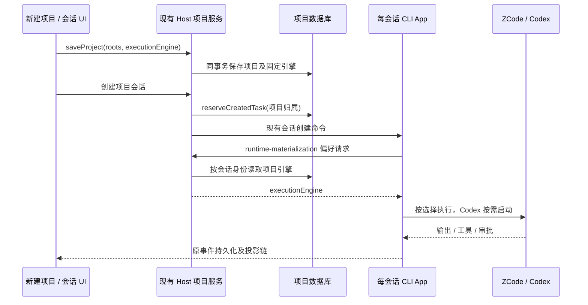

# 项目执行引擎

## 用户行为

新建项目提供「执行引擎」选项：ZCode（默认）和 Codex。用户保存后，该项目创建及恢复的会话由所选引擎执行。旧项目、没有项目归属的任务、没有配置引擎的兼容调用均保留 ZCode 默认行为。引擎选择与 API 服务商、模型选择是两个独立设置；Codex 使用 ZCode 已有的 API 服务商配置，当前限 OpenAI Responses 与 API Key。

引擎在项目创建后固定；编辑项目只读展示。恢复已删除项目保留原选择，打开已有目录并复用项目不修改选择。任务只允许在相同引擎的项目之间移动；不允许通过整理项目把已有会话切换执行引擎。同一目录可属于多个不同引擎的项目，必须按任务归属解析，禁止根据 cwd、目录名前缀或进程级环境猜测项目。

未预留项目归属的旧任务及自动化定义只允许沿旧目录规则归入唯一的 ZCode 项目；Codex 项目不能成为旧事实的目录推断候选，避免晚到的历史会话被切换引擎。执行旧 migration 时尚无引擎列，全部候选仍视作 ZCode；不改变原 migration SQL 或摘要。

Codex 由用户单独安装。选择 Codex 的项目在首次使用时自动定位官方可执行程序，按需启动 `codex app-server --stdio`，保持现有审批、停止、会话线程映射及恢复语义。找不到程序或 API 配置不兼容时显示可操作错误，不静默使用 ZCode，不自动安装软件。使用独立的 Codex 数据目录，不修改用户原有 Codex 配置或凭据。高级显式程序路径及独立 home 覆盖仍可用于部署和测试；普通用户不需要项目路径环境变量。

## 唯一所有者与接口

- 项目数据库是 `executionEngine: "zcode" | "codex"` 的唯一所有者。新增 Host tasks-index 迁移，旧行默认 `zcode`；不修改既有迁移内容或 CLI SQLite schema。
- `IProjectService.saveProject` 只在创建时接受引擎选择。`readProjects`/`readTree` 返回选择；`prepareSession`/`resolveSessionDirectories` 从同一项目事实投影该选择，缺失按 `zcode`。
- 创建会话先复用 Host 现有 `reserveCreatedTask` 预留项目归属。CLI 在 runtime materialization 的现有反向偏好请求中读取 Host 派生的 `executionEngine`。客户端输入和 `sendText` 不提供引擎、Codex 程序路径、home 或进程环境。
- Host 只通过该 task 的项目归属解析引擎；新建、冷恢复、延迟物化及同 cwd 多项目一致。派生的子会话沿现有父会话继承入口继承引擎。显式 `zcode` 必须压过实验性的全局环境选项，避免默认项目意外进入 Codex。
- Bootstrap 在每个 session app 的装配边界选 executor。Codex 的可执行程序发现和进程 I/O 属于 CLI adapter；ZCode 原有模型循环仍是 ZCode 项目的执行者。Host、Main、UI 不直接启动 Codex，也不维护第二份输入队列或运行事实。

现有 owner/lease、workspaceIdentity、stale generation 与 CommandInbox 不变。Desktop continuous 与手机 replayable 均连接同一 Host 与同一会话，不创建额外手机引擎。远端项目在其所属 Host 查找可执行程序及读取配置；旧远端没有新能力时仍兼容默认 ZCode，不宣称旧远端支持 Codex。

## UI 与验收

字段顺序为项目名称、设备、执行引擎、源文件夹。选择器复用已有 Select 与中英文文案，默认 ZCode；保存过程中禁用，编辑时只读。显示 Codex 需要单独安装及支持的服务商类型，不把环境变量写入产品使用流程。

交互实现前维护 E2E。运行证据覆盖：默认项目仍为 ZCode；Codex 项目保存及重启后保留；同 cwd 两种项目分别创建会话且执行链隔离；Codex 项目两个会话均进入官方 Codex；API 请求沿 ZCode 选择；已有 ZCode 会话恢复仍走 ZCode；Codex 不存在时明确失败且不回退；项目编辑/恢复/同引擎移动保留选择，跨引擎移动拒绝。CLI adapter/bootstrap 测试验证 trusted preference 路由、发现失败、显式覆盖、独立 home 和无旧环境污染；App 业务不新增单测，以真实运行与 E2E 验收。
